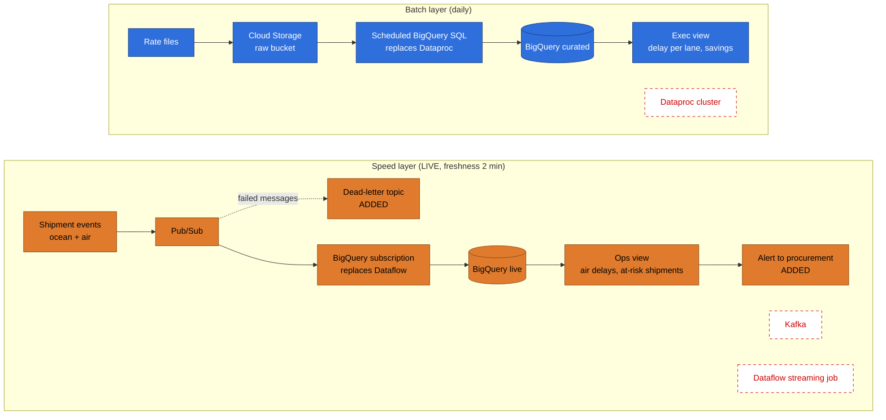

# Platform architecture for SHP05 Vertex Auto Parts

Orange = live (must meet 2-minute freshness). Blue = batch (scheduled). Red dashed = crossed out.

## Decisions
- **Live:** events, Pub/Sub, BigQuery subscription, BigQuery live, Ops view, alert. The 2-minute freshness target and a possible line stop justify it.
- **Batch:** rate files, Cloud Storage, scheduled SQL, curated tables, Exec view. They change daily and feed negotiations, not alarms.
- **Crossed out:** Kafka, the Dataflow streaming job and the Dataproc cluster. Each is an always-on cost the $50 budget can't carry at this data volume.
- **Added:** dead-letter topic and alert.
- **Reliability:** the targets are 95% on air and 65% on ocean. The Ops view tracks both, but only air delays trigger an immediate alert. Ocean is reviewed daily in the Exec view.